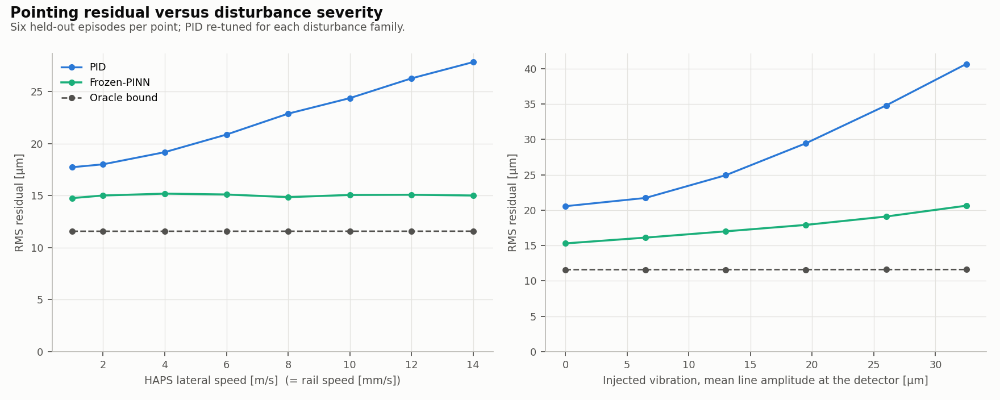
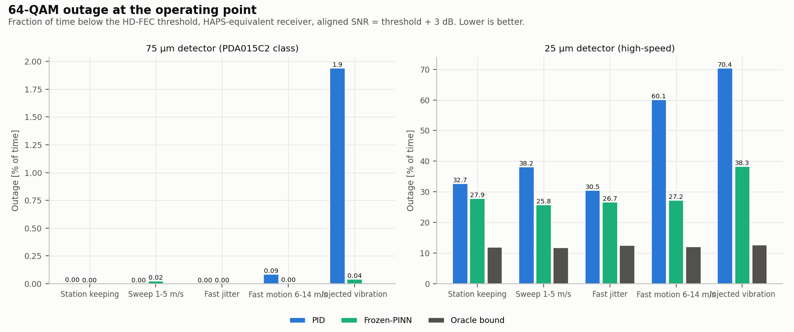

# Frozen-PINN 지향 제어 (HAPS FSO, 벤치 실험)

HAPS–지상 자유공간 광통신 수신기의 FSM 지향 제어입니다. PSD 프레임만으로 교란의 맥락을 학습해 지연 너머를 예측하고(Frozen-PINN 예측기), FSM 동역학을 만족하는 명령을 한 번에 냅니다(Frozen-PINN 물리 잔차 명령층). 대기 굴절률 Δn은 필요 없습니다. 기준 제어기는 같은 PSD 정보를 받는 PID입니다.

실험 장치는 송신부를 레일로 평행이동하는 30 cm 벤치입니다. FSM–검출기 지렛대가 HAPS 수신기 렌즈 초점거리와 같아서, 벤치 잔차를 HAPS 초점면 잔차로 환산할 수 있습니다.

결과는 두 갈래로 나뉩니다.

| 갈래 | 입력 | 출력 | 그림 |
|---|---|---|---|
| **분석(analytical)** | 벤치 모델(장비 사양 + 레일 교란) | `results/analytical/<run>/` | A01–A12 |
| **실측(empirical)** | 벤치 로그(PSD, 명령, 레일, USRP) | `results/empirical/<session>/` | E01–E08 |

두 갈래는 같은 지표와 같은 그림 형식을 씁니다. 모든 그림은 PNG(미리보기), PDF(pdflatex), EPS(latex·IEEE 제출)로 함께 저장되고, 글꼴은 TrueType으로 내장됩니다. 분석 실행이 저장한 제어기(`models/`)를 그대로 벤치에 올리고, 그 로그를 실측 갈래로 분석합니다.

## 핵심 결과 (분석 갈래, 벤치 모델 시뮬레이션)

| | 위치 유지 | 빠른 이동 6–14 m/s | 진동 주입 6–18 Hz |
|---|---|---|---|
| RMS 잔차 PID → Frozen-PINN [µm] | 16.3 → 15.1 | **24.2 → 14.9** | **29.9 → 17.8** |
| 25 µm 검출기 outage | 32.7 → 27.9% | **60.1 → 27.2%** | **70.4 → 38.3%** |
| 25 µm 검출기 데이터율 [Mb/s] | 42.7 → 44.0 | **33.3 → 44.2** | **27.6 → 41.1** |
| 75 µm 검출기 outage | 0 → 0 | 0.09 → 0% | **1.94 → 0.04%** |

- PID는 교란군마다 다시 튜닝했고, Frozen-PINN은 섞인 데이터로 한 번만 학습했습니다.
- 통신 지표는 측정 잔차를 HAPS 수신기 모델에 넣은 등가값이며, 동작점은 64-QAM FEC 임계값 + 3 dB입니다.
- 해석과 한계는 [docs/results_analytical.md](docs/results_analytical.md)에 있습니다.

<p>


</p>

## 구조

```
config/bench.json            벤치 사양, 교란군, 제어기·평가 설정 (두 갈래 공통)
config/focal_mode.json       렌즈 초점면 구성(이전 벤치 v2) 설정, 테스트용
pat/                         라이브러리
  spec.py optics.py          설정 로드, 광학 응답
  disturbance.py plant.py    레일·진동 교란, 0.5 ms 벤치 루프(FSM, PSD, 지연)
  predictor.py               Frozen-PINN 교란 예측기, 온라인 재적합, 저장/불러오기
  command_layer.py           Frozen-PINN 물리 잔차 명령층 (FSM ODE)
  controllers.py             PID, Frozen-PINN 제어기, Oracle
  comm.py qam.py             HAPS 등가 링크: BER, outage, 적응 QAM, 심볼 시뮬레이션
  empirical.py               벤치 로그 → 지표
  figures.py                 공통 그림 스타일과 그림 함수
experiments/
  run_analytical.py          분석 갈래 전체 실행 (약 12분)
  run_empirical.py           실측 갈래: 로그 분석 + 그림
  make_synthetic_logs.py     실측 갈래 리허설용 합성 로그
  make_figures.py            그림(A*, E*)과 RESULTS.md 다시 만들기
tests/                       단위·통합 테스트
docs/                        방법, 벤치, 결과, 실측 절차, 원고
data/empirical/<session>/    벤치 로그
results/{analytical,empirical}/
legacy/                      이전 연구(v1 PDF 기준, 벤치 v2, v3 이력), 로컬 보관
```

## 실행

`requirements.txt`(numpy, scipy, matplotlib)가 필요합니다. 검증 환경은 Python 3.12, numpy 2.4, scipy 1.17, matplotlib 3.10입니다.

```bash
PY=/opt/anaconda3/envs/nlos/bin/python
export PYTHONDONTWRITEBYTECODE=1

$PY -m unittest discover -s tests -t .                       # 테스트
$PY experiments/run_analytical.py --name main                # 분석 갈래 (results/analytical/main)
$PY experiments/make_figures.py --analytical results/analytical/main   # 그림만 다시 (PNG·PDF·EPS, --formats로 선택)

# 실측 갈래 리허설: 합성 로그 → 분석 (그림에 SYNTHETIC DRY RUN 표시)
$PY experiments/make_synthetic_logs.py --analytical results/analytical/main --session data/empirical/synthetic_dryrun
$PY experiments/run_empirical.py --session data/empirical/synthetic_dryrun

# 실측: 벤치 로그를 data/empirical/<session>/ 에 넣고
$PY experiments/run_empirical.py --session data/empirical/<session>
```

## 문서

| 문서 | 내용 |
|---|---|
| [docs/method.md](docs/method.md) | 문제, POL 재구성, Frozen-PINN 예측기, 재적합, 물리 잔차 명령층, 통신 지표, 코드 대응 |
| [docs/bench.md](docs/bench.md) | 광학 배치, HAPS 환산, 장비 모델, 교란군, 측정할 가정 |
| [docs/results_analytical.md](docs/results_analytical.md) | 분석 갈래 결과와 해석 |
| [docs/empirical_protocol.md](docs/empirical_protocol.md) | 벤치 실험 절차, 로그 형식, 실행 |
| [docs/paper/main.tex](docs/paper/main.tex) | 원고 (그림은 `results/analytical/main/figures`) |
| [docs/reference/PAT_reference.pdf](docs/reference/PAT_reference.pdf) | 원래 PDF 모델 |

## 이전 연구 (legacy/)

`legacy/`는 용량 때문에 로컬에만 보관합니다(설명은 `legacy/README.md`).
- PDF 기준 v1: Δn이 필요한 Frozen-PINN 광장 계산, 잠금 포함, 그 폴더 안에서 독립 실행됩니다.
- 벤치 v2: 렌즈 초점면 구성
- v3 실행 이력
