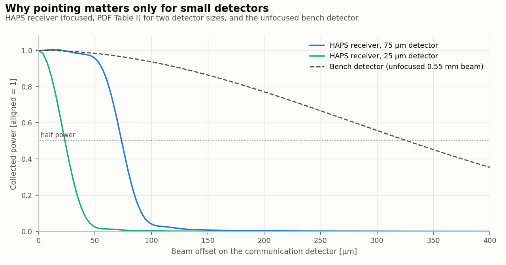
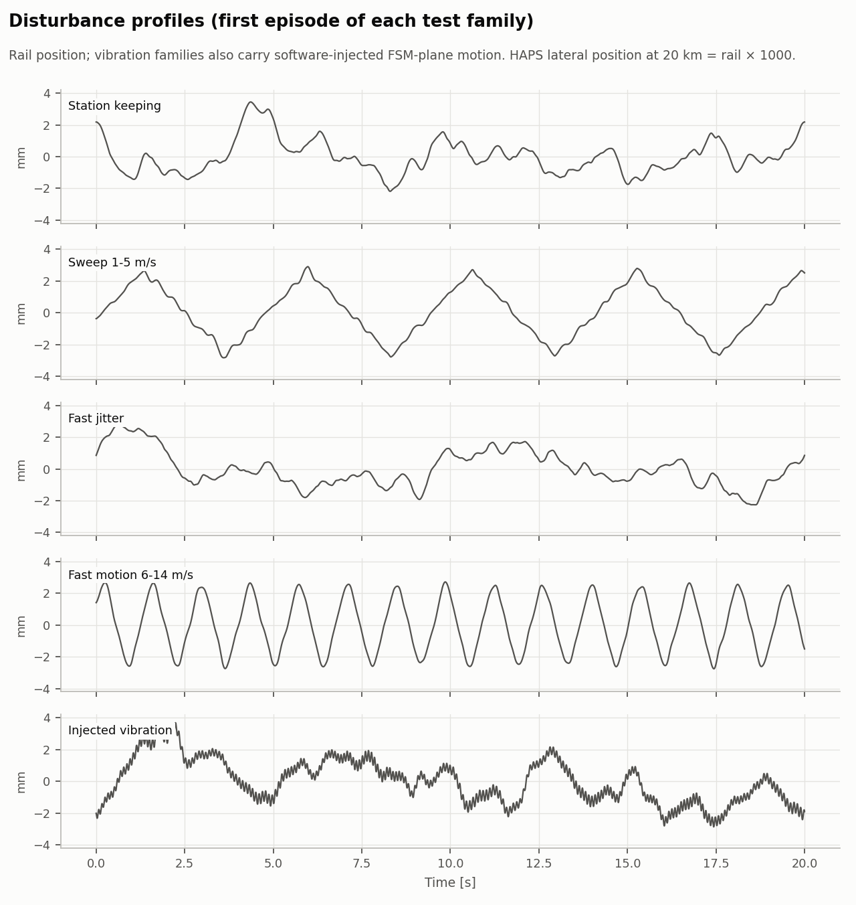
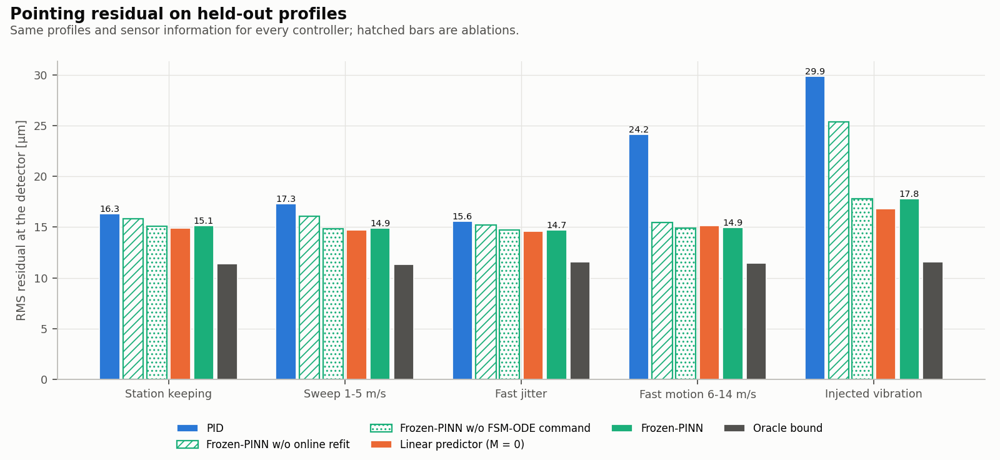
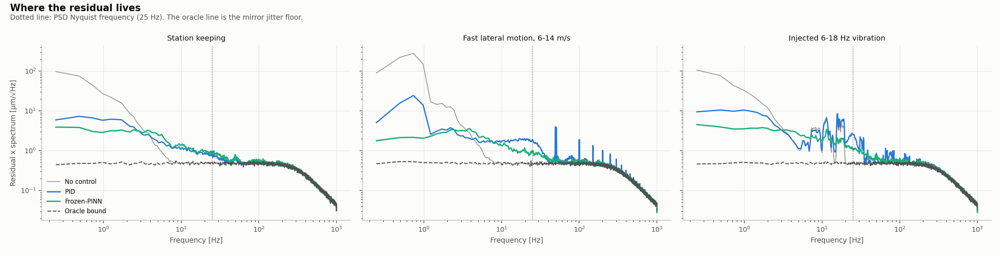
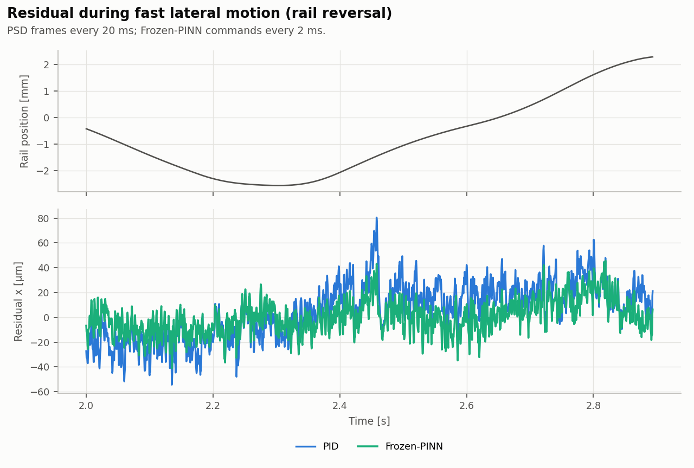
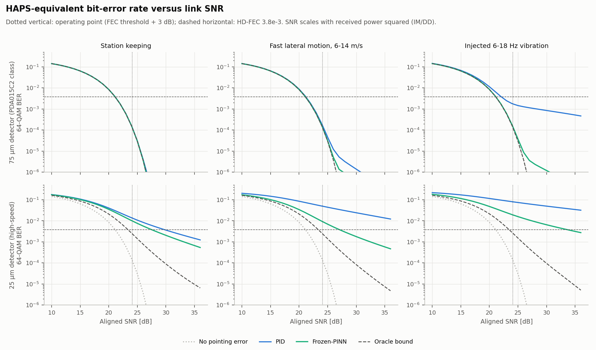
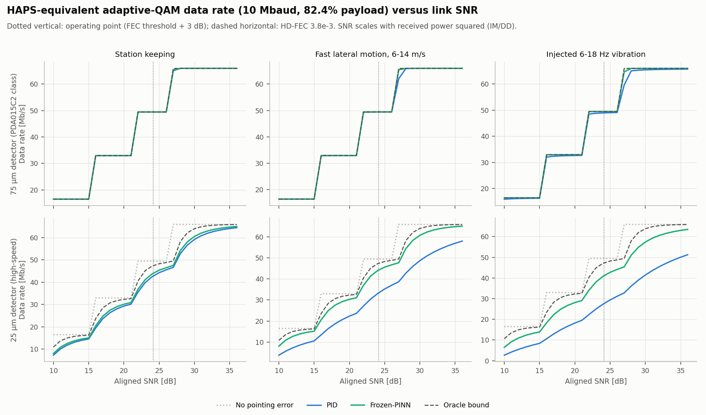
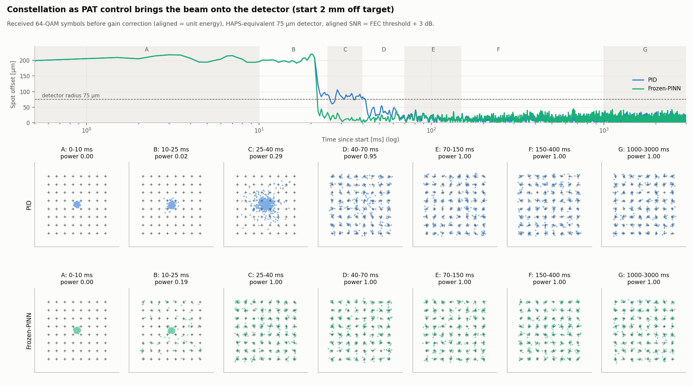
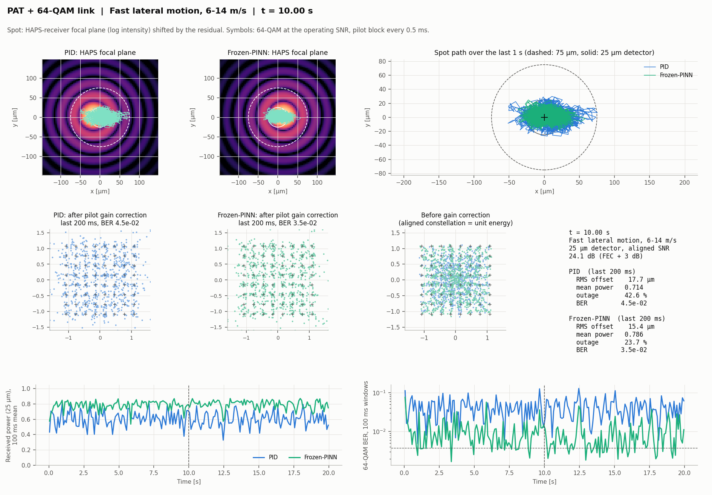
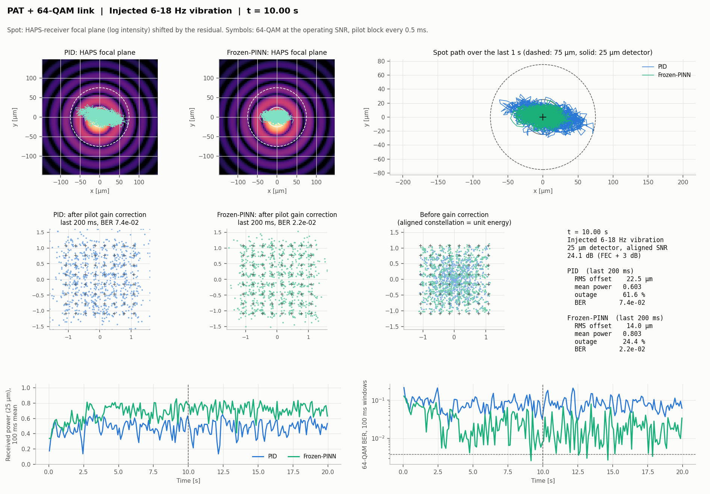

# Analytical figures (bench model + HAPS-equivalent link)

## A01_capture_function

검출기 오프셋에 따른 수집 전력. HAPS 수신기(초점면)에서 75 µm 검출기는 ±40 µm까지 평평하고, 25 µm 고속 검출기는 수 µm부터 전력이 줄어든다. 벤치 검출기(렌즈 없는 0.55 mm 빔)는 수백 µm에서야 줄어든다.

[PNG](A01_capture_function.png) · [PDF](A01_capture_function.pdf) · [EPS](A01_capture_function.eps)

## A02_disturbance_profiles

시험 교란군별 첫 에피소드의 레일 위치(진동군은 FSM에 주입한 성분을 레일 등가로 포함). 20 km HAPS 횡변위 = 레일 × 1000.

[PNG](A02_disturbance_profiles.png) · [PDF](A02_disturbance_profiles.pdf) · [EPS](A02_disturbance_profiles.eps)

## A03_pointing_summary

시험 세트별 RMS 지향 잔차(검출기면 µm = HAPS 초점면 µm). 빗금은 ablation: 온라인 재적합 제거, FSM-ODE 명령층 제거. 주황은 선형 예측기(M = 0).

[PNG](A03_pointing_summary.png) · [PDF](A03_pointing_summary.pdf) · [EPS](A03_pointing_summary.eps)

## A04_rms_vs_severity

HAPS 횡속도와 주입 진동 진폭에 따른 RMS 잔차. PID는 교란 세기에 따라 커지고 Frozen-PINN은 지터 하한 근처를 유지한다.

[PNG](A04_rms_vs_severity.png) · [PDF](A04_rms_vs_severity.pdf) · [EPS](A04_rms_vs_severity.eps)

## A05_residual_spectra

잔차 x축 스펙트럼. PID는 저주파 추종 지연과 진동선이 남고, Frozen-PINN은 25 Hz 이하 성분을 상쇄한다. 점선(oracle)은 MR-15-30 지터 하한.

[PNG](A05_residual_spectra.png) · [PDF](A05_residual_spectra.pdf) · [EPS](A05_residual_spectra.eps)

## A06_tracking_window

빠른 이동 중 레일 반전 구간의 잔차. PID는 등속 구간에서 뒤처지고 반전에서 크게 벗어난다.

[PNG](A06_tracking_window.png) · [PDF](A06_tracking_window.pdf) · [EPS](A06_tracking_window.eps)

## A07_ber_vs_snr

HAPS 등가 링크의 64-QAM BER 대 정렬 SNR. 위: 75 µm, 아래: 25 µm 검출기.

[PNG](A07_ber_vs_snr.png) · [PDF](A07_ber_vs_snr.pdf) · [EPS](A07_ber_vs_snr.eps)

## A08_rate_vs_snr

적응 QAM(4/16/64/256) 데이터율 대 정렬 SNR(10 Mbaud, 페이로드 82.4%).

[PNG](A08_rate_vs_snr.png) · [PDF](A08_rate_vs_snr.pdf) · [EPS](A08_rate_vs_snr.eps)

## A09_outage

동작점(64-QAM FEC 임계값 + 3 dB)에서의 outage. 75 µm는 진동 주입에서만, 25 µm는 모든 교란에서 차이가 난다.

[PNG](A09_outage.png) · [PDF](A09_outage.pdf) · [EPS](A09_outage.eps)

## A10_acquisition

2 mm 어긋난 상태에서 시작한 획득 과정과 constellation(보정 전, 75 µm). Frozen-PINN은 첫 PSD 프레임(20 ms) 직후 한 번에 맞추고 PID는 40-70 ms에 맞춘다.

[PNG](A10_acquisition.png) · [PDF](A10_acquisition.pdf) · [EPS](A10_acquisition.eps)

## A11_dashboard_fast_sweep

Fast lateral motion, 6-14 m/s: HAPS 초점면 스폿 영상과 검출기 원(점선 75 µm, 실선 25 µm), 최근 1초 궤적, 최근 200 ms constellation, 25 µm 수신 전력과 BER 시계열(t = 10 s).

[PNG](A11_dashboard_fast_sweep.png) · [PDF](A11_dashboard_fast_sweep.pdf) · [EPS](A11_dashboard_fast_sweep.eps)

## A12_dashboard_vibration

Injected 6-18 Hz vibration: HAPS 초점면 스폿 영상과 검출기 원(점선 75 µm, 실선 25 µm), 최근 1초 궤적, 최근 200 ms constellation, 25 µm 수신 전력과 BER 시계열(t = 10 s).

[PNG](A12_dashboard_vibration.png) · [PDF](A12_dashboard_vibration.pdf) · [EPS](A12_dashboard_vibration.eps)

