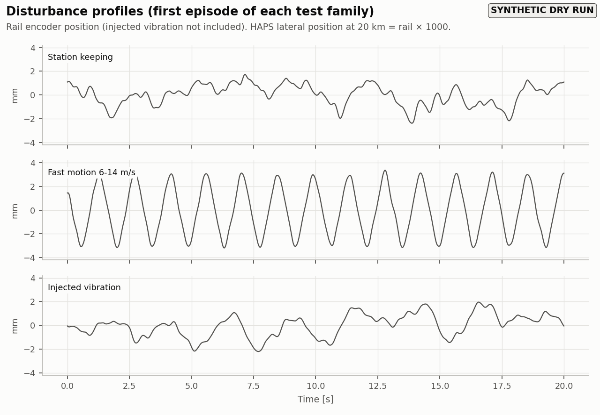
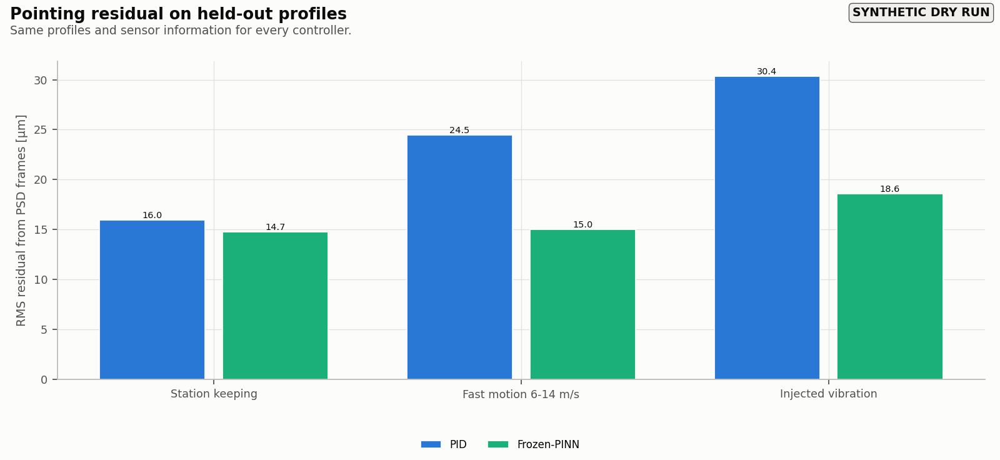
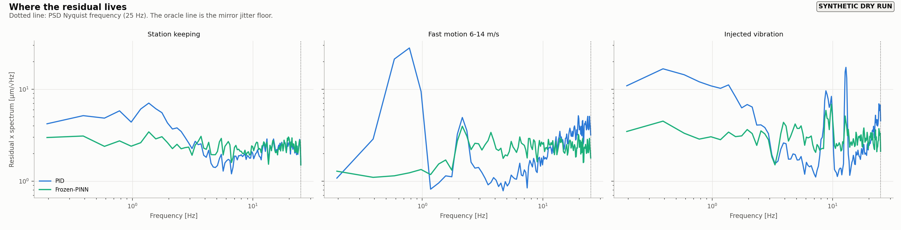
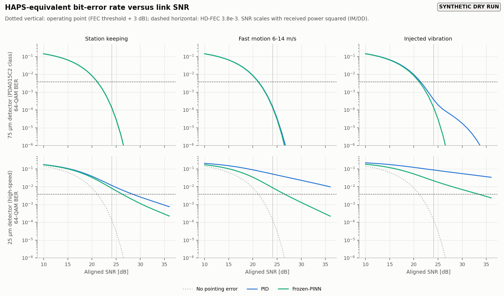
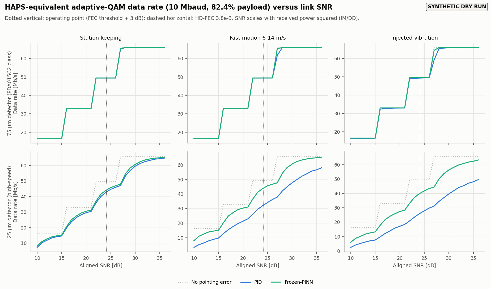
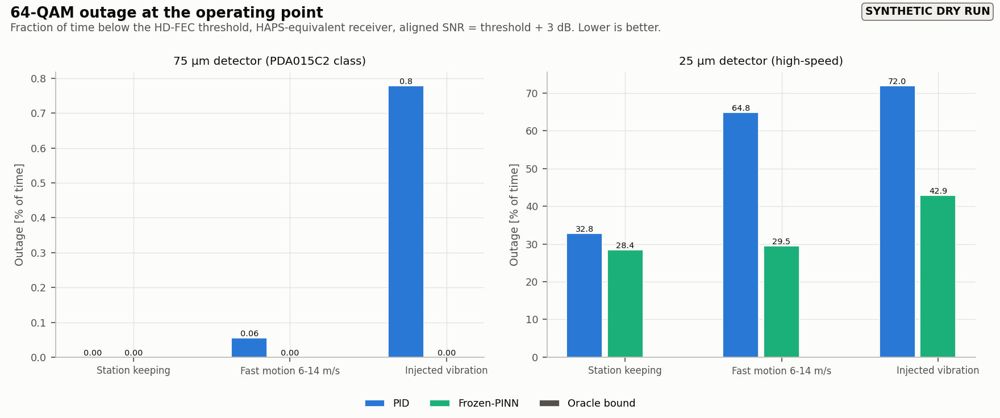
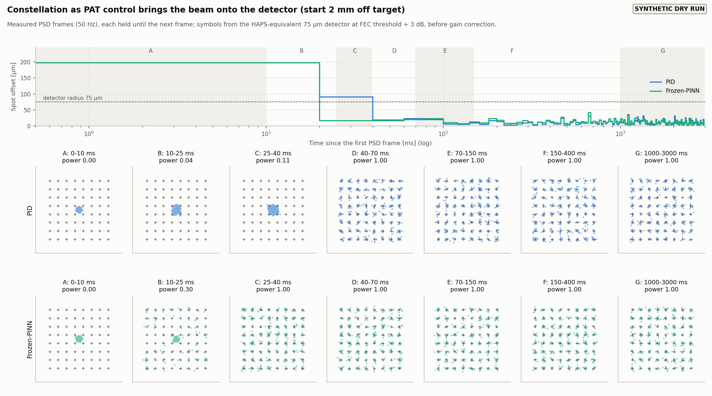
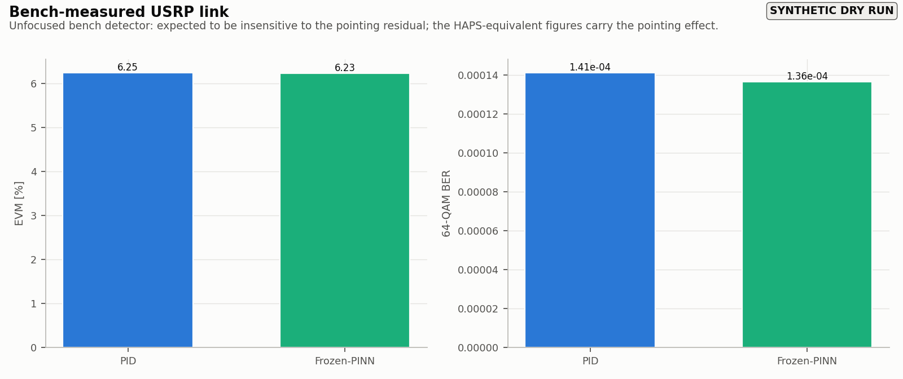

# Empirical figures (measured bench logs)

> SYNTHETIC DRY RUN - logs generated by the bench model, not measured

## E01_disturbance_profiles

측정한 레일 엔코더 위치(각 프로파일의 첫 실행). FSM 명령에 주입한 진동은 포함하지 않는다.

[PNG](E01_disturbance_profiles.png) · [PDF](E01_disturbance_profiles.pdf) · [EPS](E01_disturbance_profiles.eps)

## E02_pointing_summary

PSD 프레임(50 Hz)으로 측정한 RMS 잔차. PSD 잡음을 포함하며 프레임 사이의 움직임은 보이지 않는다.

[PNG](E02_pointing_summary.png) · [PDF](E02_pointing_summary.pdf) · [EPS](E02_pointing_summary.eps)

## E03_residual_spectra

측정 잔차 스펙트럼(PSD 프레임 기준, 25 Hz까지).

[PNG](E03_residual_spectra.png) · [PDF](E03_residual_spectra.pdf) · [EPS](E03_residual_spectra.eps)

## E04_ber_vs_snr

측정 잔차를 HAPS 수신기에 넣은 64-QAM BER 대 SNR.

[PNG](E04_ber_vs_snr.png) · [PDF](E04_ber_vs_snr.pdf) · [EPS](E04_ber_vs_snr.eps)

## E05_rate_vs_snr

측정 잔차를 HAPS 수신기에 넣은 적응 QAM 데이터율 대 SNR.

[PNG](E05_rate_vs_snr.png) · [PDF](E05_rate_vs_snr.pdf) · [EPS](E05_rate_vs_snr.eps)

## E06_outage

측정 잔차 기반 동작점 outage.

[PNG](E06_outage.png) · [PDF](E06_outage.pdf) · [EPS](E06_outage.eps)

## E07_acquisition

측정한 획득 과정과 그에 대응하는 HAPS 등가 constellation. PSD 프레임 사이 값은 보간하지 않고 직전 프레임 값을 유지한다.

[PNG](E07_acquisition.png) · [PDF](E07_acquisition.pdf) · [EPS](E07_acquisition.eps)

## E08_bench_usrp_link

벤치에서 USRP로 직접 측정한 EVM/BER. 렌즈 없는 벤치 검출기라 지향 잔차에 둔감할 것으로 예상된다.

[PNG](E08_bench_usrp_link.png) · [PDF](E08_bench_usrp_link.pdf) · [EPS](E08_bench_usrp_link.eps)

