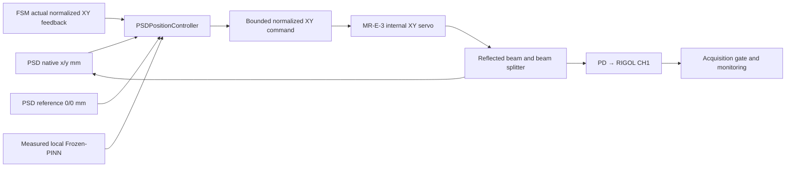

# 실제 FSM–PSD 테스트베드 PINN 검증

Optotune MR-E-3/MR-15-30, Newport CONEX-PSD10GE, Thorlabs PDA015C2와
RIGOL MSO1104Z를 연결한 **수신단의 로컬 Frozen-PINN 위치 제어 코드**입니다.
실제 사용한 코드, 교정 데이터, 학습 계수와 기록된 폐루프 측정값을 함께 제공합니다.
장비를 연결하지 않고 모델과 기록 데이터를 먼저 검증할 수 있습니다.

기준 upstream commit: `1192e7e92b885bfcb72e1c712948c8624cd3b3b5`.
`solver/frozen_pinn.py`의 `FrozenPINNBasis`와 `solver/optimization.py`의
제약 최적화 함수를 재사용합니다. 이 폴더의 코드는 20 km 대기 전파 방정식을
PSD 관측으로 역추정하거나 upstream의 통신 검출 전력 최적화 실험을 재현하지 않습니다.
현재 검증한 목적은 실제 PSD 좌표를 기준점 `(0, 0) mm`로 복귀·유지하는 것입니다.

## 검증 상태

| 항목 | 실제 확인 내용 |
|---|---|
| 고정 광원 → FSM → BS → PSD/PD 구성 | 실측 25점으로 모델 생성: 계수 fitting 20점, withheld 평가 5점 |
| withheld 좌표 RMS | **0.00539797 mm**: 두 좌표 성분에 대한 RMS, 절대 위치 정확도 인증이 아님 |
| 고정 광원 재획득 실험 | FSM 오정렬로 PD/PSD 신호를 잃은 뒤 bounded scan으로 재획득하고 PINN 중심 유지로 전환 |
| 당시 초기 중심 유지 구간 | 기록된 8개 샘플의 위치 오차 norm RMS **0.00990358 mm** |
| 최종 고정 광원 운전 기록 | 889개 tracking 샘플. 정상 종료 상태는 `cancelled`: viewer/watchdog/device가 lease를 취소한 것으로 기록 |
| 새 Tx/Rx GBE10-C 구성 | **아직 수신 확보·재교정·PINN 폐루프 검증 전** |
| PSD 중심 = PD 최대 수광점 | 기계적 branch 정렬과 2축 전력 scan으로 확인 필요 |
| Zaber 독립 운동 중 PAT | 아직 검증 전. 최근 Zaber `WR` reference 경고 있음 |

측정 시점과 장비 상태는 [인계 문서](docs/handoff.md)에 정리했습니다.
이전 모델의 유효 영역은 기록된 FSM feedback 좌표의 convex hull입니다.
새 GBE 광학 배치에 이전 모델을 바로 적용할 수 있다고 가정하지 않습니다.

## 입력, 출력과 제어 관계



- `PSDPositionPINN`: 입력은 **실측 FSM mirror feedback `q=(qx,qy)`**, 출력은
  **예측 PSD 위치 `p_hat(q)` [mm]**와 analytic Jacobian `J(q)` [mm/normalized XY].
- 학습 데이터는 실제 `q, p` 쌍입니다. 광선의 국소 1차 관계
  `∂p/∂q ≈ G`를 derivative residual로 함께 fitting합니다.
  `G`의 부호·축 혼합·축별 scale은 실제 두 축 probe에서 얻습니다.
- 제어기 입력은 현재 native PSD 위치, 실제 mirror feedback, 이전 setpoint와
  PSD reference입니다. 후보 명령에서 `p_measured + p_hat(q_new) - p_hat(q_actual)`을
  평가하고, 위치 오차의 제곱을 줄이는 제약 최적화로 다음 XY 명령을 구합니다.
- 출력 명령은 **거울 자세의 normalized XY**입니다. PSD mm나 거울 위 빔의 위치가
  아닙니다. 실제 mirror 자세는 내부 센서에서 별도로 읽습니다.
- 외부 PAT PID/KF는 사용하지 않습니다. MR-E-3 내부의 mirror position servo는 사용합니다.
- Zaber 실제 위치나 알려진 송신기 trajectory는 이 위치 제어기의 입력에 없습니다.
- PD 전압은 현재 위치 제어의 목적함수에 들어가지 않습니다. 재획득 옵션에서 detection
  gate로 쓰며, `0,0`이 최대 수광점이 되려면 별도의 물리적 PSD/PD branch 정렬이 필요합니다.
- PSD 표시값은 native `1GP`의 x/y [mm]입니다. Y 반전이나 예측값으로 실측을 덮어쓰지 않습니다.
  거울 자세와 PSD 좌표 사이의 반전·scale 차이는 실측 Jacobian으로 처리합니다.

## 코드 위치

| 파일 | 역할 |
|---|---|
| `psd_position_pinn.py` | 위치 모델 학습·저장·예측·analytic derivative와 명령 계산 |
| `run_psd_pinn.py` | 실제 acquisition → PSD 중심 유지/시험 궤적의 외부 제어 루프 |
| `reference_trajectory.py` | upstream periodic angular law를 PSD commissioning reference로 scale |
| `live_psd_server.py`, `live_pat_gui.html` | PSD/FSM/CH1의 단일 소유 acquisition broker와 LAN GUI |
| `calibration/manual_fsm.py`, `xy_motion.py` | 내부 XY servo, 실제 feedback, bounded command와 자동 제어 lease |
| `calibration/rigol_scope.py`, `shared_acquisition.py` | RIGOL VXI-11/SCPI와 로컬 broker interface |
| `calibration/laser_termite.py` | 기존 Termite 세션으로 확인된 Optilab source 통신 |
| `calibration/verify_psd_feedback.py` | 실측 2축 교정과 25점 중심 map 수집, `--train-pinn` 학습 |
| `calibration/fsm_reacquisition.py` | 신호 상실 확인, bounded receiver scan, PD/PSD 재획득 |
| `calibration/inspect_mounted_receiver.py` | 새 GBE 구성의 bounded FSM/Zaber 수신 점검 |
| `calibration/measure_mounted_source_power.py` | 당시 32 → 34 mA 비교와 powered detector dark 측정 |
| `receiver_pinn.py` | 공유 upstream import와 예외, 별도 Gaussian PD coupling 모델 prototype |
| `check_psd_position_pinn.py` | synthetic 수치 검증: derivative, disturbance correction, hull/명령 제한, serialization |
| `reproduce_validation.py` | 저장된 실측 데이터·모델·운전 기록을 장비 없이 재검증 |

`receiver_pinn.py`의 별도 PD coupling 모델은 현재 사용한 PSD 위치 제어기와 구별해야 합니다.
여기에 PD 전력 최적화용 실측 validated 모델은 제공하지 않습니다.
각 원본 파일의 SHA-256과 publication 변경은 `publication_provenance.json`에 기록했습니다.
핵심 위치 제어 계산은 원본과 같으며, upstream import 위치만 저장소 root로 조정했습니다.

## 장비 없이 실행

저장소 root에서 실행합니다. Python 환경의 실제 버전은 `runtime_versions.json`에 있습니다.
이 경로에는 Optotune SDK, serial 연결 또는 오실로스코프가 필요하지 않습니다.

```powershell
python -m venv .venv-validation
.\.venv-validation\Scripts\python.exe -m pip install -r validation/requirements.txt
.\.venv-validation\Scripts\python.exe validation/check_psd_position_pinn.py
.\.venv-validation\Scripts\python.exe validation/reproduce_validation.py
```

첫 명령은 **synthetic fixture**에서 수치 동작을 확인합니다.
두 번째 명령은 **기록된 실제 데이터**로 재학습·withheld 평가, 저장된 모델의 derivative와
물리 실험의 중심 유지 구간을 확인합니다. 새로운 하드웨어 실험을 수행하지 않습니다.
결과는 `validation/calibration/`에 생성됩니다.

## 하드웨어에서 재개

하드웨어 코드는 Windows/Termite 환경을 사용합니다. 설치된 vendor USB/COM driver와
Optotune SDK Python package가 필요합니다. 드라이버 설치 파일과 SDK 자체는 이 폴더에
재배포하지 않습니다. `requirements-hardware.txt`에 사용한 Python package 버전을 적었습니다.
Python 3.13 이상에서 VXI-11의 `xdrlib` import를 위해 `standard-xdrlib`를 포함합니다.

아래 동작은 실제 장비에 연결합니다. 먼저 새 GBE 경로의 빔이 FSM 거울과 PSD의 유효
영역에 들어오도록 정렬하고, [인계 문서](docs/handoff.md)의 현재 제한을 확인합니다.
예시 network/COM 값은 `testbed_config.example.json`에 있으며 server의 CLI로 설정합니다.
다른 장비에서는 코드의 model/serial identity check도 해당 장비에 맞춰 검토해야 합니다.

```powershell
python -m pip install -r validation/requirements-hardware.txt
python validation/live_psd_server.py --bind 192.168.0.30 --viewer-ip 192.168.0.36 `
  --psd-port COM4 --fsm-port COM5 --scope-ip 192.168.10.2 --scope-source-ip 192.168.10.3
```

GUI: `http://192.168.0.30:8765/`. 같은 장비의 기존 monitor가 실행 중이면 그것을 함께
사용해야 합니다. 이 publication 작업은 기존 실험용 monitor와 장비 설정을 변경하지 않았습니다.
server를 새로 실행하면 새 로컬 인증값을 가진 `calibration/live_gui_connection.json`이 생성됩니다.
이 파일을 Git에 올리지 않습니다. 연결된 GUI viewer의 heartbeat/Stop과 단일 소유 lease를 사용합니다.

새 교정 시 `verify_psd_feedback.py`와 현재 position-loop source check는 **32 mA**를 기준으로
작성되어 있습니다. 최근 mounted GBE 진단 후의 광원은 **34 mA**입니다. 교정·운전 source 설정을
먼저 일치시켜야 하며, 이 publication 과정에서 광원을 바꾸지는 않았습니다.
`calibrate_source_off_dark.py`는 명시적으로 실행할 때 source current를 잠시 0으로 두고
전기적 dark/PSD offset을 측정한 뒤 원래 current를 복구합니다.

```powershell
# 정렬 및 source 조건 확인 후 새 2축 map을 측정하고 학습
python validation/calibration/verify_psd_feedback.py --skip-circles --train-pinn `
  --output validation/calibration/new_geometry.json

# 수치 검증 통과, 실제 spot/feedback이 새 map 안에 있고 source 조건이 같은 경우
python validation/run_psd_pinn.py --model validation/calibration/new_geometry_PINN_model.json --seconds 30
```

`--reacquisition-test`는 실제 FSM을 오정렬해 신호를 잃은 뒤 bounded scan을 수행합니다.
`--trajectory figure-eight` 또는 `github-periodic`은 수신단 commissioning 시험입니다.
원래 upstream의 0.5 s angular disturbance 시간을 그대로 재현하지 않으며, 실제 spot 도착 후
다음 reference로 진행합니다. 모델 hull, 실제 feedback, 수광 신호·edge margin, stale data,
coil current와 viewer/watchdog 상태를 계속 검사합니다.

## 데이터 읽기

- `evidence/fixed_source_20261012/`: 25점 실측 map, 당시 학습 모델 `.json/.npz`,
  재획득/중심 유지 확인, 전체 889점 운전 기록과 읽기 쉬운 CSV.
- `evidence/mounted_GBE_20261012/`: 이후 새 GBE 구성에서 수행한 실제 stage/FSM probe,
  reference warning에 따른 중단, dark와 source power 비교. **실패·미검증 결과를 그대로 포함합니다.**
- `evidence/offline_checks/`: 이 publication copy에서 수행한 수치/기록 데이터 검증 결과.

`.npz`는 `allow_pickle=False`로 읽는 수치 배열입니다. runtime token, 로컬 개인 경로,
누적 GUI/장비 로그와 설치 파일은 publication에 포함하지 않았습니다.
PD dBm 표시는 **현재 CH1 평균 전압에서 측정한 dark를 빼고** responsivity·load gain으로
변환한 nominal estimate이며, 절대 광전력 교정값이 아닙니다.
historical peak voltage를 현재 수신 전력으로 사용하지 않습니다.
